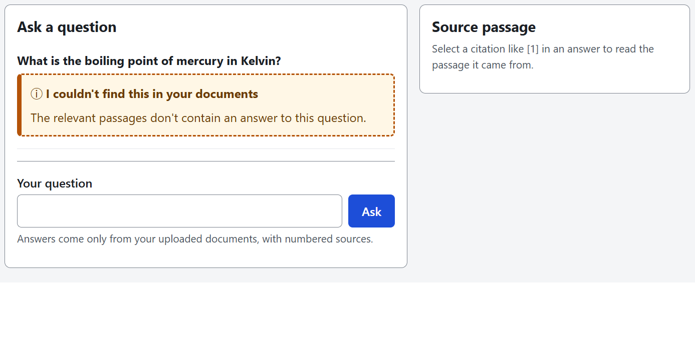
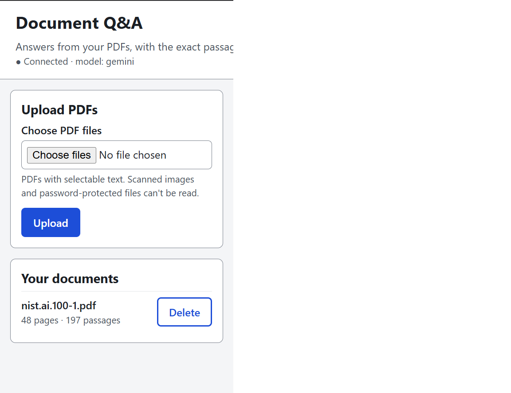
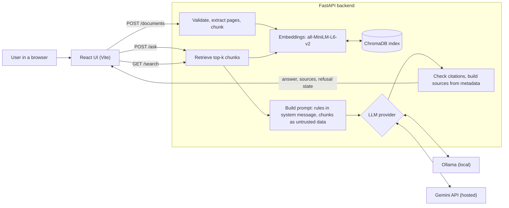

# RAG Document Q&A with Citations

[](https://github.com/Sarthak-1729/rag-document-qa/actions/workflows/ci.yml)

Upload PDFs and ask questions in plain language. Answers come only from your documents and
cite the document, the PDF page and the exact passage. If the answer isn't in the documents,
the app says it doesn't know.

The project includes a repeatable [evaluation](#results) on public documents, with its
weaknesses reported alongside its strengths.

## Screenshots

An answer with numbered citations, with the cited passage open in the source panel:

![Answer listing the four AI RMF functions with citations [1] and [2], and the source panel showing the passage from nist.ai.100-1.pdf, PDF page 25](docs/screenshots/answer.png)

A question the document can't answer, shown as a labeled refusal rather than an error:



The upload panel and document list:



## Features

- **PDF upload:** one or more files, with checks on type, content and size, duplicate
  detection, and safe file names. Documents can be listed and deleted.
- **Local retrieval:** text is extracted per page, split into overlapping chunks, embedded
  with `all-MiniLM-L6-v2` and stored in a persistent ChromaDB index.
- **Citations built by the server:** the model cites chunks as `[1]`, `[2]`. The server keeps
  only valid citations and takes the document name, page and passage from its own metadata,
  so page numbers are never taken from the model.
- **Refusals:** the app shows a distinct "I couldn't find this in your documents" state when
  the model says it doesn't know or gives an answer with no valid citation. An optional
  relevance threshold can also refuse before the model is called.
- **Choice of LLM:** [Ollama](https://ollama.com) (local, the default) or the Google Gemini API
  (hosted), selected with an environment variable.
- **Prompt-injection awareness:** rules live only in the system prompt. Document text is
  escaped, wrapped in delimiters and labeled as untrusted data.
- **Accessible UI:** landmarks, a skip link, labeled inputs, full keyboard operation, live
  regions for new answers and errors, and status that never relies on color alone.

## Architecture



## Quick start with Docker

You need Docker with Compose. The first build downloads CPU-only PyTorch and the embedding
model, so it takes a while.

```bash
git clone https://github.com/Sarthak-1729/rag-document-qa.git
cd rag-document-qa
cp .env.example .env
```

Choose an LLM in `.env`:

- **Gemini:** set `LLM_PROVIDER=gemini` and `GEMINI_API_KEY=<your key>`. Get a key from
  [Google AI Studio](https://aistudio.google.com/apikey).
- **Ollama:** keep `LLM_PROVIDER=ollama`, install Ollama on your computer and run
  `ollama pull llama3.2:3b`. On Linux, Ollama must also listen on the Docker network, for
  example with `OLLAMA_HOST=0.0.0.0`.

```bash
docker compose up --build
```

Open <http://localhost:8080>. The API runs at <http://localhost:8001>, with interactive docs at
`/docs`. Uploads and the index are kept in the `rag-data` volume, and `docker compose down -v`
deletes them.

## Local development

You need Python 3.11+ and Node.js 24. The commands below are for Git Bash on Windows; on Linux
or macOS, use `.venv/bin/python` instead of `.venv/Scripts/python`.

```bash
cp .env.example .env
```

Backend, in one terminal:

```bash
cd backend
python -m venv .venv
.venv/Scripts/python -m pip install -e ".[dev]"
.venv/Scripts/python -m uvicorn app.main:app --reload --port 8001
```

Frontend, in another terminal:

```bash
cd frontend
npm install
npm run dev
```

Open <http://localhost:5173>.

## Configuration

Settings are environment variables, read from `.env` in the repository root. See
[`.env.example`](.env.example). Never commit `.env`.

| Variable | Default | Purpose |
|---|---|---|
| `LLM_PROVIDER` | `ollama` | `ollama` or `gemini` |
| `LLM_MAX_TOKENS` | `1024` | Maximum tokens per answer (for Gemini, includes thinking tokens) |
| `LLM_TIMEOUT_SECONDS` | `60` | Timeout for each LLM call |
| `OLLAMA_BASE_URL` | `http://localhost:11434` | Ollama address (Docker uses `DOCKER_OLLAMA_BASE_URL` instead) |
| `OLLAMA_MODEL` | `llama3.2:3b` | Ollama model |
| `OLLAMA_NUM_CTX` | `8192` | Ollama context window |
| `GEMINI_API_KEY` | empty | Required when `LLM_PROVIDER=gemini` |
| `GEMINI_MODEL` | `gemini-3.5-flash-lite` | Gemini model |
| `GEMINI_THINKING_LEVEL` | `minimal` | `minimal`, `low`, `medium`, `high` or empty; support varies by model |
| `ASK_TOP_K` | `5` | Chunks sent to the model per question |
| `MIN_RELEVANCE_SCORE` | empty (off) | Refuse before calling the model if the best chunk scores lower; see [why it's off](backend/eval/README.md#why-min_relevance_score-stays-off) |
| `ASK_RATE_LIMIT_PER_MINUTE` | `10` | `/ask` requests per client IP per minute; `0` disables it |
| `CORS_ORIGINS` | `http://localhost:5173,http://127.0.0.1:5173` | Allowed browser origins (Docker sets this for you) |
| `DATA_DIR` | `data` | Uploads and index, relative to `backend/` (Docker uses `/data`) |
| `MAX_UPLOAD_MB` | `20` | Size limit per file |
| `MAX_FILES_PER_UPLOAD` | `10` | Files per upload request |
| `EMBEDDING_MODEL` | `sentence-transformers/all-MiniLM-L6-v2` | Embedding model |
| `CHUNK_SIZE` | `800` | Chunk size in characters |
| `CHUNK_OVERLAP` | `150` | Overlap between chunks in characters |

Docker Compose and frontend only:

| Variable | Default | Purpose |
|---|---|---|
| `BACKEND_PORT` | `8001` | Backend port on your computer |
| `FRONTEND_PORT` | `8080` | Frontend port on your computer |
| `DOCKER_OLLAMA_BASE_URL` | `http://host.docker.internal:11434` | Ollama address from inside the container |
| `VITE_API_URL` | `http://localhost:8001` | Backend URL used by the browser; set at build time, in `frontend/.env.local` for local development |

## API

| Method | Path | Request | Response |
|---|---|---|---|
| `GET` | `/health` | | `{status, version, llm_provider, documents}` |
| `POST` | `/documents` | multipart `files` | `201` and `[{id, filename, pages, chunks, uploaded_at}]` |
| `GET` | `/documents` | | The same list of documents |
| `DELETE` | `/documents/{id}` | | `204`, or `404` |
| `GET` | `/search` | `?q=...&k=5` | `{query, results: [{doc_id, doc, page, text, score}]}` |
| `POST` | `/ask` | `{question, k?}` | `{answer, sources: [{n, doc_id, doc, page, text}], refused, refusal_reason}` |

- `page` is always the 1-based physical page index in the PDF, not the printed page number.
- Upload errors: `400` empty file or too many files, `409` duplicate, `413` too large, `415` not
  a PDF, `422` no readable text (for example, scanned or encrypted).
- `/ask` errors: `409` no documents, `422` invalid input, `429` rate limited (with
  `Retry-After`), `502`/`503`/`504` provider problems.
- `refusal_reason` is `low_relevance`, `model`, `uncited` or `null`.

## Tests

Tests use fake embeddings and a fake LLM, so they need no API key, model download or network.

```bash
cd backend
.venv/Scripts/python -m ruff check app tests eval
.venv/Scripts/python -m pytest -q --cov --cov-report=term-missing
```

```bash
cd frontend
npm run lint
npm test
npm run build
```

[GitHub Actions](.github/workflows/ci.yml) is set up to run these on every push and pull request.

## Evaluation

The benchmark has 30 hand-verified questions on three public U.S. Government documents: NIST AI
RMF 1.0, NIST CSF 2.0 and the U.S. Constitution. [`backend/eval/README.md`](backend/eval/README.md)
explains the method and metric definitions.

```bash
cd backend
.venv/Scripts/python -m eval.fetch_docs
.venv/Scripts/python -m eval.run_eval --skip-llm
.venv/Scripts/python -m eval.run_eval
.venv/Scripts/python -m eval.report eval/results/<run>.json
```

`--skip-llm` measures retrieval only and needs no API key. The full run uses the LLM set in
`.env`.

## Results

These numbers come from the generated report for the final run, `20261102-093423`, using
`gemini-3.5-flash-lite` on 2026-11-02. They are copied from
`python -m eval.report`, not typed by hand.

<!-- generated by: python -m eval.report eval/results/20261102-093423.json -->
_Run `20261102-093423` · 2026-11-02T09:34:23+00:00 · commit `d2dcabe` · questions: VERIFIED (30/30 verified) · embeddings `sentence-transformers/all-MiniLM-L6-v2`, chunks 800/150_

**Retrieval** (25 answerable questions; hit = the expected PDF page is among the top-k chunks; lenient also accepts other pages containing the supporting phrase)

| Questions | n | hit@1 | hit@3 | hit@4 | hit@5 |
|---|---:|---:|---:|---:|---:|
| all (strict: expected page) | 25 | 32% | 68% | 72% | 72% |
| all (lenient: any page with the phrase) | 25 | 36% | 68% | 72% | 72% |
| doc=CDOC-110hdoc50.pdf | 8 | 25% | 62% | 62% | 62% |
| doc=NIST.AI.100-1.pdf | 9 | 56% | 67% | 78% | 78% |
| doc=NIST.CSWP.29.pdf | 8 | 12% | 75% | 75% | 75% |
| phrasing=close | 12 | 33% | 83% | 83% | 83% |
| phrasing=paraphrased | 13 | 31% | 54% | 62% | 62% |

**Relevance threshold** (top-1 cosine similarity)

| | min | median | max |
|---|---:|---:|---:|
| Answerable (n=25) | 0.414 | 0.662 | 0.780 |
| Unanswerable (n=5) | 0.176 | 0.402 | 0.485 |

- Threshold chosen on all 30 (in-sample, optimistic): `0.516`, keeps 23/25 (92%) answerable, refuses 5/5 (100%) unanswerable.
- Leave-one-out (out-of-sample): keeps 23/25 (92%) answerable, refuses 4/5 (80%) unanswerable.
- Only 5 unanswerable questions: treat refusal estimates as rough.

**Answering** with `gemini` / `gemini-3.5-flash-lite` (max tokens 1024, threshold off during the run)

| Metric | Result |
|---|---:|
| Unanswerable questions refused | 5/5 (100%) |
| Answerable questions falsely refused | 4/25 (16%) |
| Answers citing the expected page | 17/21 (81%) |
| Answers citing any page that contains the supporting phrase (lenient) | 18/21 (86%) |
| Answers whose first citation is the expected page | 11/21 (52%) |
| With threshold `0.516`: unanswerable refused | 5/5 (100%) |
| With threshold `0.516`: answerable falsely refused | 5/25 (20%) |
<!-- end of generated report -->

**How to read these numbers:**

- **Small sample.** There are 25 answerable and 5 unanswerable questions. One question moves
  an answerable rate by 4 points and an unanswerable rate by 20 points, so these are rough
  signals, not precise estimates.
- **Paraphrased questions are weak.** Compare `phrasing=paraphrased` with `phrasing=close`
  above. Retrieval struggles when a question uses different words from the document.
- **The threshold was tuned on the same set.** The in-sample threshold result is optimistic.
  The leave-one-out line is the fairer estimate. `MIN_RELEVANCE_SCORE` stays off by default
  because the model already refused all 5 unanswerable questions, and the threshold added a
  false refusal.
- **A hit means the right page, not a right answer.** The script doesn't score answer
  correctness. `hit@5` matches the app's setting of 5 chunks per question.
- **Results vary between runs.** Citation details changed across three runs. See the
  [run-to-run comparison](backend/eval/README.md#run-to-run-variance).

## Limitations

- **Text extraction artifacts:** PDF text can include broken hyphenation ("illus- trated"),
  stray spaces and repeated page headers. Text in images isn't extracted, and neither are some
  tables (the main function table in CSF 2.0 comes out empty). Scanned PDFs are rejected because
  there is no OCR.
- **Retrieval weakness:** summaries, glossaries and index pages can outrank the page that
  actually states the answer. When the answer isn't retrieved, the model correctly refuses, so
  a retrieval miss appears as a false refusal.
- **Free-tier privacy:** Google's pricing page says free-tier Gemini content is used to improve
  its products. Use public documents only with that tier, or use Ollama to keep everything local.
- **No authentication:** anyone who can reach the API can read, upload and delete documents. Run
  it locally or behind your own access controls, and don't expose it to the internet as it is.
- **Single user:** all documents share one index, and there are no per-user workspaces.
- **Prompt injection is reduced, not eliminated:** a malicious document can't change the page or
  document shown in a citation, but it could still influence the answer text. Tests check the
  prompt structure and escaping; resistance hasn't been measured against a live model.
- **Evaluation scope:** only Gemini was evaluated. Ollama's adapter is tested against faked HTTP
  responses, and answer quality with local models is unmeasured.
- **Simple limits:** the upload size check runs after the file is received, and the rate limit is
  per process, in memory, and sees a proxy's IP when deployed behind one.

## Future work

- Improve retrieval and measure it: hybrid keyword and vector search, a reranker, a stronger
  embedding model, and smaller or structure-aware chunks.
- Reduce the influence of index and table-of-contents pages.
- Add scored answer correctness and a larger question set with more unanswerable questions.
- Measure prompt-injection resistance against a live model.
- Add OCR for scanned PDFs and better table extraction.
- Add authentication and per-user document collections.
- Evaluate local models through Ollama.

## License

[MIT](LICENSE) © 2026 Sarthak Shukla
